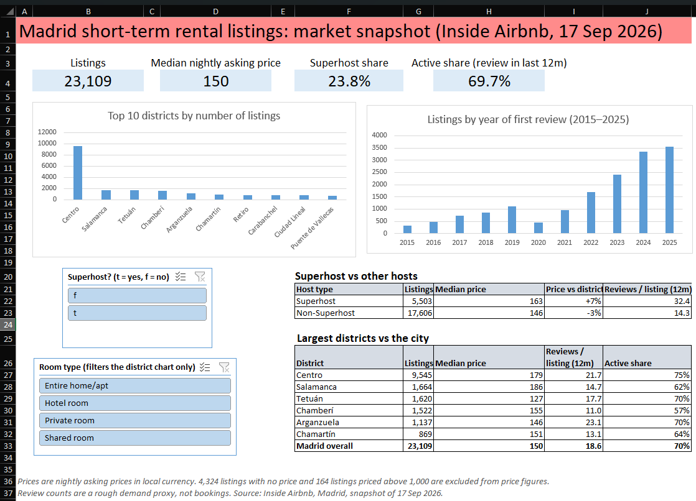

# Madrid Short-Term Rental Market Snapshot (Excel)

An end-to-end Excel analysis of 23,109 Madrid Airbnb listings: Power Query cleaning, pivot tables and charts, slicers, XLOOKUP and dynamic-array formulas, and a one-page dashboard. No VBA or macros.



## Why I built this

My other projects (SQL on job-market data, a Power BI churn dashboard, an A/B test) don't show Excel, even though Excel is on my resume. I built this to show a complete analyst workflow in Excel: clean messy data, answer business questions, build a dashboard, and write up findings with their limits. I learned several of these techniques while building it.

## Business questions

Scenario: I'm an analyst at a company that manages short-term rentals in Madrid, and my manager wants to know where to focus.

1. Which districts and room types combine a strong asking price with strong recent review activity, so where should we focus onboarding?
2. Do Superhosts price differently from other hosts, and do they get more reviews?

## Data

- **Source:** Inside Airbnb, Madrid, snapshot of 17 September 2026 (`listings.csv`, 23,109 rows). Download it from the "Get the Data" page at insideairbnb.com. Please check the site for licence terms. The raw data is not included in this repository.
- **Not used:** `reviews.csv` exceeded Excel's 1,048,576-row limit, so I excluded it and used the review fields already in the listings file (`number_of_reviews_ltm`, `first_review`).

## What I did

**Cleaning (Power Query)**
- Kept 22 relevant columns out of about 91.
- Checked `id` for duplicates and found none (23,109 distinct ids in 23,109 rows).
- Removed `host_since` and `host_response_rate`, which were 100% empty in this snapshot.
- Trimmed and cleaned the text columns, and confirmed the date columns parsed with 0 errors.
- 4,324 listings (18.7%) have no price. I did not impute them. They are left out of price figures only.
- Flagged 164 listings priced above 1,000 per night as outliers (0.9% of priced listings). Many of the most extreme prices looked like placeholders (for example, a run of listings at exactly 15,000). The cutoff is a judgement call, and it moved the median price only from 151 to 150. That leaves 18,621 listings for price analysis.
- 1,729 `minimum_nights` values are blank. I kept them, because neither question needs that field.

**Analysis**
- Pivot tables, pivot charts and slicers (room type and Superhost) for the top 10 districts by listings.
- A district summary built with `UNIQUE`, `SORT`, `COUNTIFS`, `SUMIFS` and `MEDIAN(FILTER(...))`.
- `XLOOKUP` across sheets to compare each listing's price with its own district's median.
- Year-over-year growth % and a running total using pivot "Show Values As".
- A one-page dashboard with KPI cards, charts, slicers and two comparison tables.

**Checking my work.** Counts reconcile (4,324 + 164 + 18,621 = 23,109), the pivot and a formula agree (Centro, Private room: 2,122 in both), and the weighted Superhost share matches the overall 23.8%. The formulas are on the `Checks` sheet.

## Key findings

1. **Centro dominates supply and looks busy.** 9,545 of 23,109 listings (41.3%) are in Centro, and the six largest districts hold 70.8%. Centro's median asking price (179) is above the city's (150), and its listings average 21.7 reviews in the last 12 months against 18.6 citywide.
2. **Higher prices don't go with more review activity.** Salamanca (186) and Chamberí (155) have high asking prices but below-average review activity (14.7 and 11.0 reviews per listing). Arganzuela (146) shows 23.1.
3. **Superhosts list at higher prices within their own district.** The median Superhost listing is 7% above its district median and the median non-Superhost listing is 3% below. Superhosts also average more reviews (32.4 vs 14.3), but that gap is partly built into how the badge is earned.
4. **New-listing growth slowed, and many listings look inactive.** Listings getting a first review grew 42% in 2023 and 40% in 2024, but only 5.9% in 2025. 30.3% of listings had no review in the last 12 months.

The full write-up with recommendations is in `screenshots/03_summary.png` and on the `Summary` sheet.

## Limitations

- **Asking prices, not revenue.** Price is the nightly asking price in the data's local currency. It says nothing about what guests paid or how often a place was booked. I deliberately did not estimate revenue or occupancy.
- **Reviews are a rough proxy for demand, not bookings.** Superhost status depends partly on activity, so Superhosts' higher review counts do not show that the badge causes more demand.
- **One snapshot only.** The growth chart counts listings that still exist today by the year of their first review. Older years are understated, and it does not measure market growth. 2026 is a partial year (snapshot dated 17 September) and is excluded from the chart.
- **Missing data is not random.** 8.5% of Superhost listings have no price, against 22.8% of other listings, so the price comparison covers a different share of each group.
- **No controls for room type or capacity** in the Superhost comparison. It shows an association, not a cause.
- **Small samples.** Shared rooms (153 listings) and hotel rooms (39) are too few for conclusions. Two districts have fewer than 100 priced listings (Vicálvaro, 50, and Villa de Vallecas, 77) and are flagged.
- **The outlier rule is a judgement call**, and I did not trim the low end of the price range.
- **Madrid, not India.** This demonstrates technique on a real public dataset. It says nothing about the Indian market.
- **Refreshing needs a path change.** Power Query points to a local file path. The cleaned data is already in the workbook, so it opens fine, but "Refresh" requires you to place `listings.csv` locally and update the source step.

## Files

```
madrid-airbnb-excel-analysis/
├── madrid_airbnb_analysis.xlsx
├── dashboard.pdf
├── README.md
└── screenshots/
    ├── 01_dashboard.png
    ├── 02_power_query_steps.png
    ├── 03_summary.png
    └── 04_district_summary.png
```

## Skills demonstrated

Power Query (cleaning, type fixes, calculated columns), pivot tables and pivot charts, slicers, `XLOOKUP`, dynamic-array formulas (`UNIQUE`, `SORT`, `SORTBY`, `FILTER`), `COUNTIFS` / `SUMIFS`, dashboard design, and documenting data-quality decisions and limitations.

## Attribution

Data: Inside Airbnb (insideairbnb.com), Madrid, snapshot of 17 September 2026.
